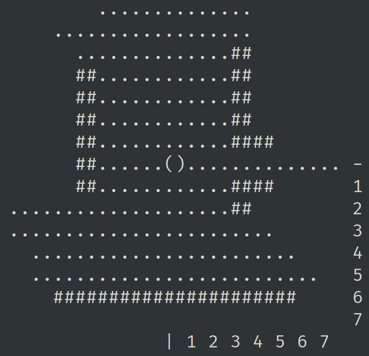

# A simple pre-calculated 2D Field of View PoC

## Pre-calculated octant


## Example results



## How-To

### Run viewer

```sh
uv sync
uv run -m fov.viewer
```

`WASD` or arrow key moves, `Q` or Esc quits.

### Generate a new FoV and test it

```sh
uv run -m fov.generator --size 15 --circle --output fov_31x31.txt
uv run -m fov.viewer --fov fov_31x31.txt
```

Use `--help` for detailed command line help.
